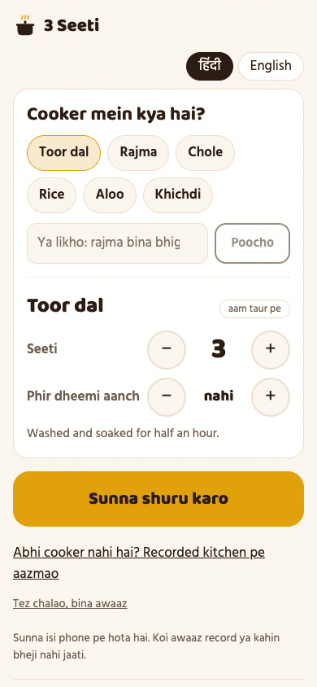
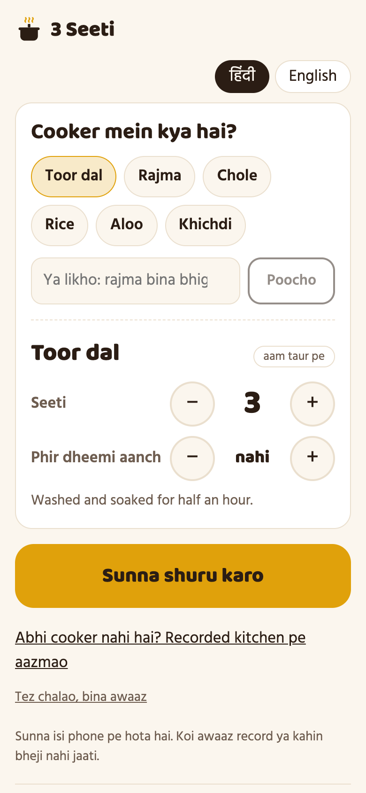
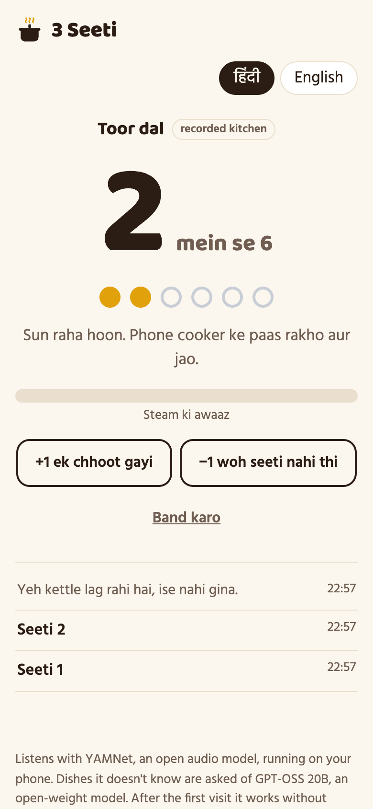
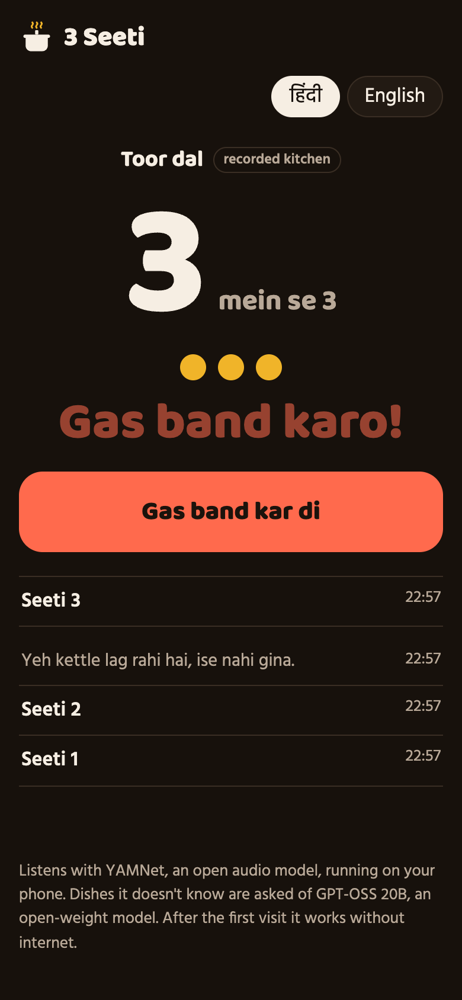

# 3 Seeti

[](https://github.com/abjt01/3-seeti/actions/workflows/ci.yml)
[](https://render.com/deploy?repo=https://github.com/abjt01/3-seeti)

Put the phone on the counter and walk away. 3 Seeti counts the pressure cooker's whistles for you and says "Teesri seeti. Gas band kar do!" when the dal is done.

In an Indian kitchen, the recipe isn't in minutes, it's in whistles: dal is 3, rajma is 6, rice is 2. So someone stands near the stove counting, or wanders off, loses count, and comes back to burnt dal. Here the counting is done by YAMNet, an open audio model from Google, running in the browser on the phone. No sound is recorded or sent anywhere, and after the first visit it works with no internet.



<table>
  <tr>
    <td></td>
    <td></td>
    <td></td>
  </tr>
</table>

## How it works

1. **Say what's cooking.** Tap a dish (dal, rajma, chole, rice, aloo, khichdi) or type anything: "rajma, forgot to soak it", "aadha kilo mutton", "kathal ki sabzi". Nineteen everyday dishes are answered from a table in the app, no internet needed. Anything else goes to GPT-OSS 20B, an open-weight model, and its answer is held to sane limits (1 to 12 whistles) before it's used. Every number can be changed with a tap.
2. **Start listening, and leave.** The screen stays on. Every quarter second, YAMNet scores the last second of sound.
3. **It talks.** "Pehli seeti. Do aur." Then "Teesri seeti. Gas band kar do!" with an alarm that repeats until you tap. In Hindi or English.
4. **The low-flame minutes.** Rajma and chole want ten minutes on low after the last whistle; the timer starts when you tap "gas band kar di".

If it misses one or counts something wrong, there's a "+1" and a "−1".

## What a whistle sounds like to a model

I ran YAMNet over 20 real recordings (all CC0, from freesound.org): pressure cookers, and the kitchen sounds that must not count. What it hears, as the highest score in each recording:

| Recording | Steam / Hiss | Whistle (tonal) |
|---|---|---|
| Indian cooker, whistle bursts | 0.89 | 0.20 |
| Other pressure cookers (some recorded from across the room) | 0.20–0.94 | up to 0.08 |
| Whistling kettles | 0.74–0.92 | **0.80–0.98** |
| Talking, TV, mixer, gas stove, kitchen background | 0.00–0.02 | 0.00 |
| Frying | 0.04–0.08 | 0.01–0.02 |

Two things in there decided the design:

- **A cooker's whistle isn't a "Whistle" to the model.** It's Steam and Hiss. The Whistle label goes to tonal sounds, and the loudest tonal sound in a kitchen is a kettle. So a whistle here is a burst of steam, and a burst of tone is a kettle.
- **A kettle steams too.** One of the kettles hisses for three and a half seconds before it starts to whistle. Counting on the first half-second of steam counted the kettle. So a burst only counts once it has ended and five more seconds have passed with no tone, or straight away if it's long. That means "teesri seeti" comes a few seconds after the whistle, which is fine for dal.

The counter itself (`lib/counter.ts`) is plain code with no model in it, and its tests run on YAMNet's real output for every one of those recordings (`test/fixtures/frames`).

## Try it without a cooker

"No cooker right now? Try a recorded kitchen" plays three and a half minutes of a kitchen through the same model and counter: talking, frying, the TV, a kettle and a mixer, and exactly three whistles a minute apart (`public/demo`, mixed from CC0 recordings by `scripts/make-demo-session.sh`). "Run it fast" does the same silently in a few seconds.

## Why open models

- **The kitchen stays private.** The model runs on the phone, so there's no audio upload and no account. That matters for a microphone left on in a home kitchen for twenty minutes.
- **It works with no internet.** The model (4 MB), its runtime and the app are kept on the phone by a service worker. Only asking about an unusual dish needs a connection.
- **It costs nothing to run, forever.** No per-minute audio API. The free model on Groq is only asked about dishes the table doesn't know, and it can be swapped for any OpenAI-compatible server, Ollama included.

## Run it

```bash
npm install
cp .env.example .env   # optional: a free Groq key, only for dishes the table doesn't know
npm run dev            # http://localhost:4310
```

Microphones need `localhost` or HTTPS, so to try it on a phone, use the deployed version or a tunnel.

## Tests

```bash
npm run lint && npm run typecheck
npm test            # the counter on real model output for 20 recordings, dishes, spoken lines
npm run build
npm run test:api    # the plan API and every file the phone needs to listen offline
npm run test:e2e    # real Chrome running the real model: every screen at 320–1280px in light and dark, then the flows
```

The browser tests run YAMNet in Chrome over the recorded kitchen and check the whole chain: three whistles, the kettle noticed and not counted, the alarm, the low-flame timer, "+1" and "−1", the microphone (Chrome's fake one, and a blocked one), and the whole thing again with the network switched off.

## Layout

```
app/                 the page, /api/plan, /healthz
components/Kitchen   the one screen: plan, listening, alarm, timer
lib/
  counter.ts         steam and tone scores in, "that was a whistle" out
  listener.ts        microphone or recording → YAMNet (MediaPipe) every quarter second
  dishes.ts          the whistle table and the limits on a model's answer
  words.ts           what it says, in Hindi and English
  plan.ts, llm.ts    asking GPT-OSS about dishes the table doesn't know
public/              the model, the offline worker, the recorded kitchen
test/                unit, API and browser tests, and the model's output for 20 recordings
```

## Limits

- It's been tested on recordings of real cookers, not yet in my own kitchen. A loud exhaust fan or a cooker in the next room may need the sensitivity setting.
- Cookers with a pressure valve that hisses non-stop (common outside India) don't whistle in bursts. It says so instead of counting.
- The phone needs to stay unlocked with the page open: browsers stop the microphone when it's locked.

## Credits

YAMNet by Google (Apache 2.0), run with MediaPipe. Kitchen recordings from freesound.org under CC0; see `public/demo/CREDITS.md` and `test/fixtures/README.md`.

## License

[MIT](LICENSE)
